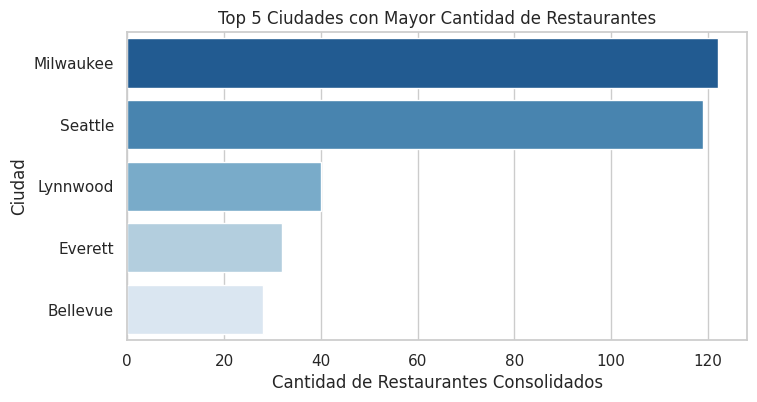
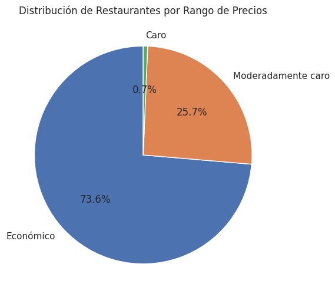
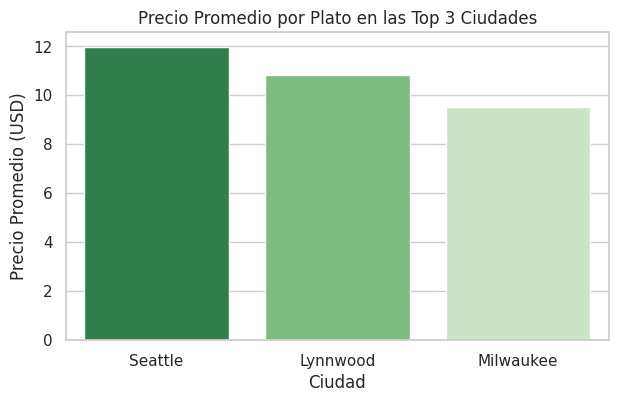
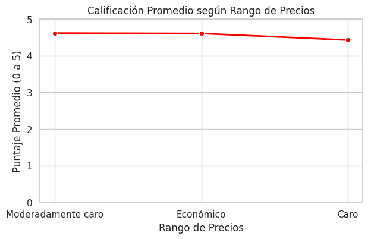

# Análisis de Datos para Food Delivery - Proyecto ETL

Este proyecto procesa y analiza la información de más de 60,000 restaurantes y sus menús en Estados Unidos. El objetivo es estructurar los datos crudos, almacenarlos en una base de datos relacional y responder a preguntas clave sobre la expansión de una plataforma de delivery.

---

## Flujo de trabajo (Pipeline ETL)

1. **Extract:** Se cargaron los archivos CSV de restaurantes y menús en DataFrames de `pandas` para revisar su estructura, volumen de filas y la presencia de valores nulos.
2. **Transform:** 
   - Se reemplazaron los símbolos de precio (`$`, `$$`, etc.) por categorías descriptivas (`Económico`, `Moderadamente caro`, etc.).
   - Se separó la columna de dirección en tres campos independientes: calle, ciudad y estado.
   - Se estandarizaron los precios de los menús convirtiéndolos a tipo de dato numérico (`float`).
   - Se filtraron los restaurantes consolidados (con más de 100 valoraciones) y se unificaron con la tabla de menús mediante un `INNER JOIN`.
3. **Load:** Se creó una base de datos relacional en SQLite (`delivery_insights.db`) y se almacenó la tabla final `master_food_data`.
4. **Business Intelligence:** Se ejecutaron consultas en SQL para responder a las preguntas de negocio y se construyeron gráficos con `matplotlib` y `seaborn`.

---

## Resultados y conclusiones

### 1. Ciudades con mayor concentración de restaurantes
Milwaukee y Seattle son las ciudades con mayor cantidad de locales consolidados. Se recomienda priorizar el inicio de operaciones en estas dos ciudades para optimizar la cobertura y los recursos iniciales.

### 2. Distribución por rango de precios
El 99.3% de los restaurantes se ubica en las categorías Económico (73.6%) y Moderadamente caro (25.7%). Esto demuestra que la oferta en el mercado está orientada principalmente al consumo masivo.

### 3. Precio promedio por ciudad
Seattle presenta el precio promedio por plato más alto ($11.98 USD) en comparación con Lynnwood ($10.82 USD) y Milwaukee ($9.53 USD), lo que sugiere un ticket promedio por pedido más elevado en esa ciudad.

### 4. Relación entre precio y calificación
La puntuación promedio otorgada por los usuarios se mantiene bastante estable (~4.6 estrellas) en los distintos rangos de precio. Un precio más alto no garantiza una mejor calificación por parte del cliente.

---

## Herramientas utilizadas

- Lenguaje: Python
- Librerías: pandas, numpy, sqlalchemy, matplotlib, seaborn
- Base de datos: SQLite
- Entorno de trabajo: Databricks